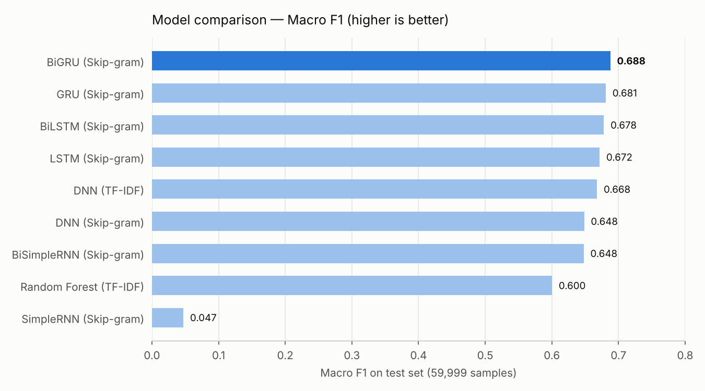
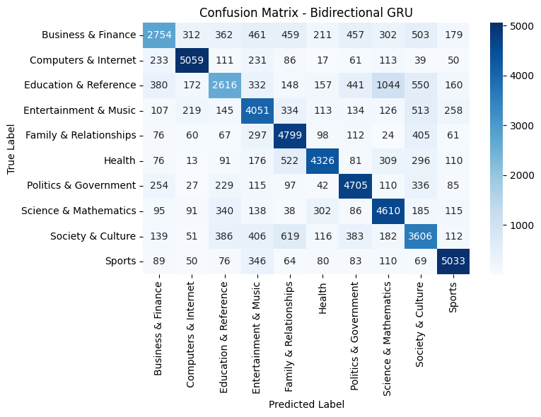

# CSE440 Project – Question-Answer Text Classification (TF-IDF, Word2Vec, RNNs)

Multi-class text classification of question-answer posts into **10 topic categories**, comparing a classical ML baseline, a feed-forward DNN and seven recurrent neural network architectures on **two text representations**: TF-IDF and Skip-gram (Word2Vec) embeddings.

**Course:** CSE440 – Natural Language Processing II, BRAC University (Fall 2025)

**Team:** Omar Faruk, Amiyo Bhowmik

**Best model: Bidirectional GRU with Skip-gram embeddings – 69.27% accuracy, 0.688 macro F1** on a 59,999-sample held-out test set.



## Dataset

| Split | Rows | Columns |
|---|---|---|
| Train | 93,333 | `QA Text`, `Class` |
| Test | 59,999 | `QA Text`, `Class` |

- Each sample is an HTML-wrapped post containing a question title, question content and best answer.
- 10 balanced classes (about 9,300 training samples each): Business & Finance, Computers & Internet, Education & Reference, Entertainment & Music, Family & Relationships, Health, Politics & Government, Science & Mathematics, Society & Culture, Sports.
- Average length about 566 characters after HTML removal (min 58, max 6,877).
- The CSVs are stored zipped in [`data/`](data) to stay within GitHub's file-size limits. pandas reads the zip files directly; no need to unzip.

## Pipeline

1. **EDA** – shape, missing values, class distribution, text-length distribution per class.
2. **Cleaning** – remove HTML tags and extra whitespace.
3. **Preprocessing** (two variants)
   - *For TF-IDF:* lowercase, remove special characters and digits, remove stopwords, **Porter stemming**.
   - *For Skip-gram:* the same steps but with **WordNet lemmatization** instead of stemming.
4. **Label encoding** with `LabelEncoder` (sparse integer labels).
5. **Feature extraction**
   - **TF-IDF:** unigrams + bigrams, top 5,000 features (`min_df=2`, `max_df=0.85`).
   - **Skip-gram Word2Vec** trained on the dataset (`vector_size=100`, `window=5`, `sg=1`, 10 epochs). It initialises a Keras `Embedding` layer over a 5,000-word vocabulary, with sequences padded or truncated to 200 tokens.
6. **Training** – 70/30 stratified train/validation split, Adam optimizer, sparse categorical cross-entropy, `EarlyStopping` + `ReduceLROnPlateau`, small hyperparameter search (batch size / learning rate) per model.
7. **Evaluation** – accuracy, macro F1, confusion matrix and classification report on the test set.

### Recurrent model architecture

All seven RNN variants share one template, with only the recurrent cell changed:

`Embedding (Skip-gram, 100-d)` → `RNN(128)` → `Dropout 0.3` → `RNN(64)` → `Dropout 0.3` → `Dense(32, ReLU)` → `Dropout 0.2` → `Dense(10, softmax)`

where RNN is SimpleRNN, GRU or LSTM, optionally wrapped in `Bidirectional`.

## Results (test set, 59,999 samples)

| Model | Features | Accuracy | Macro F1 |
|---|---|---|---|
| **Bidirectional GRU** | Skip-gram | **0.6927** | **0.6878** |
| GRU | Skip-gram | 0.6846 | 0.6809 |
| Bidirectional LSTM | Skip-gram | 0.6852 | 0.6781 |
| LSTM | Skip-gram | 0.6757 | 0.6717 |
| DNN | TF-IDF | 0.6730 | 0.6678 |
| DNN | Skip-gram | 0.6485 | 0.6485 |
| Bidirectional SimpleRNN | Skip-gram | 0.6551 | 0.6478 |
| Random Forest | TF-IDF | 0.6072 | 0.6003 |
| SimpleRNN | Skip-gram | 0.1272 | 0.0472 |

### Key findings

- **Gated RNNs (GRU/LSTM) performed best.** The bidirectional versions add a small further gain because they read context in both directions.
- **The unidirectional SimpleRNN failed to learn** (close to the 10% random-guess level). This shows the vanishing-gradient problem on 200-token sequences. Making it bidirectional recovered it to 65.5%.
- **The TF-IDF DNN was a strong, cheap baseline** (0.668 F1), ahead of Random Forest on the same features.
- **The easiest classes** were Computers & Internet, Sports, Family & Relationships and Health. **The hardest** were Education & Reference, Society & Culture and Business & Finance, which share a lot of vocabulary with other topics.



## Repository structure

```
├── text_classification.ipynb   # Full pipeline: EDA, preprocessing, features, all models, evaluation
├── data/
│   ├── train.zip               # Training set (93,333 rows)
│   └── test.zip                # Test set (59,999 rows)
├── images/                     # Figures used in this README
├── Project_Instruction.pdf     # Assignment specification
├── Project_Report.pdf          # Final IEEE-format report
└── requirements.txt
```

## How to run

**Google Colab (recommended, GPU makes the RNNs much faster):**
1. Open `text_classification.ipynb` in Colab and pick *Runtime → Change runtime type → GPU*.
2. Create a `data` folder in the Colab file panel and upload `train.zip` and `test.zip` into it.
3. *Runtime → Run all*.

**Locally:**
```bash
git clone https://github.com/Omar136796/CSE440-QA-Text-Classification.git
cd CSE440-QA-Text-Classification
pip install -r requirements.txt
jupyter notebook text_classification.ipynb
```
Training all nine models on CPU takes several hours. Use a GPU if possible. TensorFlow needs a supported Python version (3.9–3.12).

## Tech stack

Python · pandas · NumPy · NLTK · scikit-learn · Gensim (Word2Vec) · TensorFlow / Keras · Matplotlib · Seaborn

## Future work

- Fine-tune transformer models (BERT, RoBERTa) on the same task.
- Compare pretrained embeddings (GloVe, fastText) with the in-domain Skip-gram model.
- Use attention over the recurrent outputs and longer input sequences.
